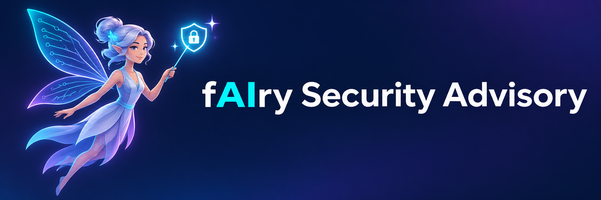
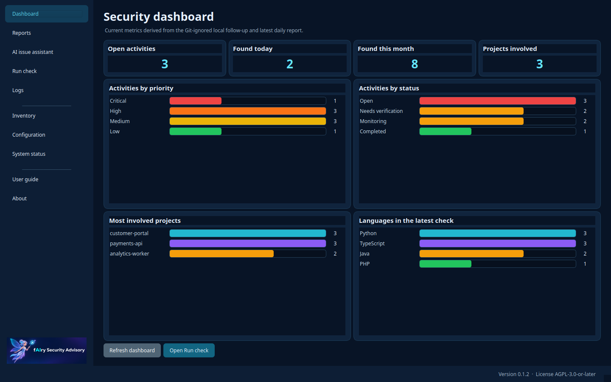
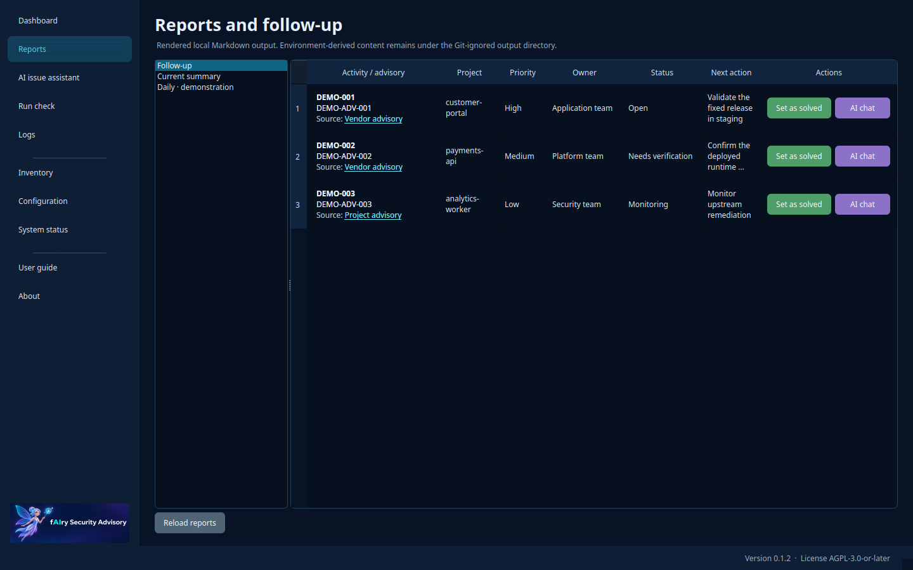

# fAIry Security Advisory



A reusable project for periodically correlating public security advisories with
the technology stack actually present in local workspaces. The workflow always
distinguishes technology presence, declared versions, verified installed
versions, and production status. Production is considered confirmed only by
system-administrator evidence or an authorized check on the relevant server.

Analysis is read-only for inventoried projects: it does not update dependencies,
change application configuration, or deploy software.

## Screenshots

The screenshots below are generated from synthetic demonstration projects and
advisory identifiers. They contain no local inventory, filesystem path,
configuration, report, account, or production information.

### Security dashboard



### Reports and follow-up



## Disclaimer

This software is provided **“AS IS”**, without warranties or guarantees of any
kind, express or implied. Security advisory data and applicability assessments
may be incomplete, outdated, or affected by errors in upstream sources, local
inventory, tool output, or interpretation.

Users are solely responsible for reviewing and independently verifying all
results before making security, operational, deployment, or remediation
decisions. Use of this software, its reports, and its recommendations is at the
user's own risk. To the maximum extent permitted by applicable law, the authors
and contributors are not liable for losses, damages, service interruptions,
security incidents, or other consequences arising from its use or misuse.

## Installation

### Requirements

- Linux, macOS, or another environment with Python 3.11 or later;
- Git, when installing from a Git repository;
- network access for advisory retrieval during a complete check;
- at least one authenticated CLI agent: Codex or Claude Code; no IDE is
  required;
- optional: OSV-Scanner, Trivy, and Docker;
- optional desktop interface: PySide6 6.x, installed into the project virtual
  environment only after confirmation.

### Install the project

Clone or download the repository and launch the project command:

```bash
git clone https://github.com/mecio/fairy-security-advisory.git
cd fairy-security-advisory
./fairy-security-advisory
```

The launcher requires only Python 3.11 initially. If the project dependencies
are unavailable, it offers to create `.venv` and install `requirements.txt`
after confirmation. It then opens the guided menu. No IDE is required.

The root command `fairy-security-advisory` is a symbolic link to the service
implementation in `scripts/fairy-security-advisory`, so the public command
remains short while executable code stays under `scripts/`.

Use option 2 to check Python, Git, configured paths, inventory freshness,
optional scanners, installed AI agents, and their authentication state. If no
supported agent is available, the launcher displays the official installation
command and documentation. Use option 3 to initialize local configuration and
option 6 to build the initial inventory.

### Supported AI agents

At least one terminal agent is required only for the complete advisory analysis:

- Codex CLI: the GUI uses OpenAI's standalone installer under `~/.local/bin`
  and `~/.codex`, without requiring Node.js or npm —
  [official OpenAI documentation](https://developers.openai.com/cookbook/examples/codex/using_goals_in_codex);
- Claude Code: the GUI uses Anthropic's recommended native installer under
  `~/.local/bin` and `~/.local/share/claude`, without requiring Node.js or npm —
  [official Claude Code documentation](https://code.claude.com/docs/en/setup#install-claude-code).

The project launcher displays the exact reviewed command and does not execute
it without confirmation. Both agents receive stable user launchers under
`~/.local/bin`; fAIry prefers those launchers while each IDE remains free to use
its managed copy. The Codex installer runs non-interactively so it never accepts
an offer to remove another managed installation. The Claude installer writes
only its native user-managed version layout. After installation, authenticate
the CLI account with its official interactive command and verify the result:

```bash
# OpenAI Codex
codex login
codex login status

# Anthropic Claude Code
claude auth login
claude auth status
```

The desktop **System status** page distinguishes `Missing` from
`Login required` and provides a **Log in** button. It opens the official command
in a visible terminal so browser/device authorization can complete normally.
Credentials, account identifiers, API keys, access tokens, and authentication
output are handled and stored only by the provider CLI; fAIry records none of
them and displays only the boolean authenticated/not-authenticated state.

The requirements check verifies both command availability and authentication
before allowing the analysis service or AI issue assistant to start.

### Optional scanners

`osv-scanner` and `trivy` are optional. When available in `PATH`, the skill uses
them to supplement the analysis. Menu option 4 detects missing tools and the
Linux family through `/etc/os-release`, then displays the relevant official
installation commands without executing them.

Review the suggested commands and explicitly approve installation before
running them: they may add system repositories, download binaries, or require
`sudo` privileges.

For OSV-Scanner on Linux x86_64 and arm64, the GUI prefers the official
precompiled release, verifies its published SHA-256 checksum, and installs it
under `~/.local/bin` without `sudo` or Go. The Go-based fallback is enabled only
after confirming that a compatible toolchain is actually available.

### Desktop application

The optional graphical branch is isolated under `desktop/` and uses PySide6
with native Qt Widgets. It does not start a web server, reserve a TCP port, or
require Docker. Start it with:

```bash
./fairy-security-advisory --gui
```

On first use, the launcher offers to install `desktop/requirements.txt` into
the isolated `.venv`. It does not install graphical dependencies without
confirmation. The same interface can be opened as menu option 12.

The desktop application provides:

- a security dashboard derived from ignored local reports, with activities
  opened today and this month, open work, involved projects, priorities,
  statuses, and languages mentioned in the latest check;
- guided forms for project roots, advisory sources, reports, AI profiles, and
  backups, plus Advanced YAML editors with validation and atomic saves;
- dedicated Codex and Claude CLI account tabs with install, login, and refresh
  actions that never store provider credentials, plus local per-provider usage
  totals and the remaining Codex allowance when the installed CLI exposes it;
- a technology inventory browser with local per-project advisory inclusion and
  optional Codex/Claude preference;
- rendered daily reports and summary, plus an interactive follow-up table with
  primary-source links for advisories and CVEs;
- a local year/month analysis-log archive with summary, event, routing, AI
  output, evidence viewing, and confirmed per-run deletion;
- an AI issue assistant linked to one open follow-up ID and project at a time;
- system and optional-tool status;
- Linux application-menu integration with contextual Install/Remove actions;
- an in-application User guide with searchable next/previous matches;
- guided, explicitly confirmed installation actions for missing agents and
  optional scanners;
- private local configuration backups with a manifest and SHA-256 checksum;
- an About section populated from the public `VERSION.yaml` metadata file;
- execution of validation, source checks, inventory refresh, pre-publication
  checks, and complete Codex or Claude analyses with streamed logs, a persistent
  active-agent loader, elapsed time, and project-group progress.

All GUI implementation files remain under `desktop/`. The command-line
launcher and AI skills continue to work without PySide6.

The sidebar **User guide** opens the versioned
[desktop manual](docs/gui-user-guide.md). Type a term and press Enter or use
**Next**/**Previous** to highlight and jump to each occurrence; searches wrap
at the beginning or end. **Back to top** returns to the contents section.

#### AI issue assistant

The desktop **AI issue assistant** page supports operational conversations
about an existing open follow-up. Select an issue before asking for advice,
reporting ownership, recording remediation evidence, or explaining why an
advisory is not applicable. The selected ID, project, CVE/advisory, priority,
owner, status, and next action are provided as context to the chosen Codex or
Claude model/profile.

AI conversations run with read-only/planning permissions. A model may propose
`take_ownership`, `resolve`, `not_applicable`, or a next-action update, but it
cannot directly edit `followup.md`. The GUI displays the exact proposed fields
and requires a separate confirmation. The deterministic updater then changes
only the row matching the selected stable issue ID; this keeps resolution
evidence attached to the correct issue even when one project has several open
activities. Resolution requires completion evidence, while non-applicability
requires a technical rationale or evidence.

Conversation histories are private local JSONL files under
`output/ai-conversations/` and are therefore excluded from Git with the rest of
`output/`. Issue context and the user message are sent to the selected external
AI provider, so secrets and credentials must not be entered in the chat.

Complete non-interactive analyses are wrapped by fAIry to record aggregate
token counts, duration, result, selected model/profile, and provider-reported
cost under `output/ai-usage/events.jsonl`. This local file is ignored by Git and
never contains provider credentials. Codex allowance data is read through the
authenticated local Codex service. For Claude subscription allowance, use
`/usage` inside Claude Code because the CLI does not currently expose that value
as a stable non-interactive command.

The Reports page lists **Follow-up** first. Its interactive table provides a
green **Set as solved** action and an **AI chat** action for every open row.
Solving requires completion evidence and updates only the selected stable ID;
AI chat opens the same issue in the assistant and prepares a remediation
question. Closed rows remain visible for history but their action buttons are
disabled.

Closed activities do not accumulate in the active table. After a confirmed
resolution, external closure, or technically justified non-applicability, they
are moved to `output/followup-archive/YYYY/MM.md` according to their last-update
date. Reports exposes each month as `Archive · YYYY / MM`, while Dashboard
monthly and historical statistics continue to include archived rows. Archiving
is write-first: the monthly archive is atomically stored before the row is
removed from `followup.md`.

### Version metadata

`VERSION.yaml` is the canonical machine-readable project identity file. It
contains the project name, semantic version, author, last-modified year, and
license identifier. Update it when preparing a release or when the modification
year changes; the desktop About page reads it at runtime rather than duplicating
these values in the GUI source.

## Configuration

The versioned files directly under `config/` are public factory defaults.
Personal choices are stored only under the Git-ignored `config/local/`
directory. At runtime each local file takes precedence over its factory
counterpart; when it is absent, the factory value is used.

- `projects.example.yaml`, `advisory-sources.yaml`, `reports.yaml`,
  `ai-agents.yaml`, `backups.yaml`, and `application.yaml`: publishable factory
  configuration;
- `config/local/projects.yaml`: private roots, inventory, and scan policy;
- `config/local/advisory-sources.yaml`, `reports.yaml`, `ai-agents.yaml`, and
  `backups.yaml`: private user overrides derived from the factory files;
- `config/local/application.yaml`: private UI preferences, including the
  `developer_tools` flag.

For the first run, select menu option 3. It creates the missing files under
`config/local/`, copying the existing legacy project configuration when
present and otherwise deriving every file from its public factory default.
The directory receives local-only permissions. Edit `project_roots` before
inventory refresh.

In the desktop application, Configuration opens in **Simple** mode. Local
projects can be managed with directory selectors, enabled states, exclusions,
and inventory limits. Advisory sources use a guided dialog for URL, source
type, filter, technologies, priority, and active state. Reports expose output
locations and classification choices; AI agents expose model and execution
profiles; Backups provides a file checklist and archive settings. Switch to
**Advanced YAML** when a setting is not exposed by a form. Structured edits
preserve unknown fields, although YAML comments and formatting may be
normalized.

The template has this structure:

```yaml
schema_version: 1
project_roots:
  - path: /path/to/source-code
    enabled: true
    label: primary-workspace
    exclude:
      - "**/.git/**"
      - "**/vendor/**"
      - "**/node_modules/**"
      - "**/.venv/**"
      - "**/venv/**"
      - "**/.cache/**"
      - "**/runtime/**"
      - "**/.sub-worktrees/**"
      - "**/*.worktrees/**"
inventory:
  generated_at: null
  refresh_after_hours: 168
  max_files_per_project: 20000
  projects: []
```

Each `exclude` entry is a glob evaluated relative to its `project_roots[].path`.
Matching directories are not traversed, and matching files are not included in
the generated inventory. A leading `**/` also matches at the root level.

After discovery, the desktop **Technology inventory** page provides a **Check**
checkbox for each local project and a **Preferred AI** selector with `-`,
`Codex`, and `Claude`. Unchecked projects remain inventoried but are excluded
from advisory correlation, dependency checks, OSV-Scanner/Trivy targets, and
new follow-up activities. `-` is the default and inherits the coordinator
selected when the complete analysis starts. An explicit Codex or Claude choice
routes that project to the matching authenticated CLI. These settings are
stored only in the ignored `config/local/projects.yaml` and survive inventory
refreshes.

Supported advisory source types are `html`, `rss`, `atom`, `json`, `api`, and
`repository`. Each source declares its name, URL, category or filter,
technologies, priority, and active status.

### AI model profiles

`config/ai-agents.yaml` provides publishable model defaults; personal model
choices are saved in `config/local/ai-agents.yaml`. The
default is `economical`, minimizing routine-check consumption while allowing a
more capable model to be selected for difficult cases:

| Profile | Codex | Claude Code | Intended use |
|---|---|---|---|
| `economical` (default) | `gpt-5.6-luna` | `haiku` | Frequent checks and initial triage |
| `balanced` | `gpt-5.6-terra` | `sonnet` | Advisory correlation and applicability analysis |
| `thorough` | `gpt-5.6-sol` | `opus` | Difficult or ambiguous investigations |

The launcher displays the selected models before starting the agent. Model
availability, aliases, plan limits, and pricing can change; review the
[official OpenAI model-selection guidance](https://developers.openai.com/api/docs/guides/model-selection)
and [official Claude Code model configuration](https://code.claude.com/docs/en/model-config)
before changing the profiles.

### Speed and consumption modes

Execution mode is independent from model choice and is configured in the same
file:

| Mode | Concurrent sources | AI sub-agents | Intended use |
|---|---:|---:|---|
| `economical` (default) | 1 | 0 | Lowest consumption and predictable sequential execution |
| `balanced` | up to 3 | up to 2 | Moderate latency and consumption |
| `fast` | up to 6 | up to 5 | Lowest latency at higher consumption |

The launcher applies the selected source concurrency during its reachability
check and passes the same limit to the AI skill. In `economical` mode the agent
must inspect sources sequentially and must not create sub-agents. In the other
modes, sub-agents are optional and bounded; the primary agent remains
responsible for merging, deduplicating, and verifying their evidence.

## Initial stack discovery

If `inventory.projects` is empty, select menu option 6 to create the inventory.

The scanner discovers Git repositories and unversioned projects, reads file
names, manifests, and lockfiles, and records languages, runtime constraints,
frameworks, dependencies, frontend/backend roles, databases, web servers,
containers, operating systems, CI/CD, IaC, and virtualization. It does not read
`.env` files or credentials and does not execute project code.

Select menu option 5 to preview the project count and detected technologies
without writing local configuration.

## AI instructions and skill adapters

Shared project rules live in `AI-INSTRUCTIONS.md`. The files `AGENTS.md` and
`CLAUDE.md` are intentionally small adapters that point Codex and Claude Code to
the same canonical instructions. Tool-specific differences belong only in the
corresponding adapter.

The canonical skill lives under `.agents/skills/fairy-security-advisory/`.
Claude Code loads the same directory through
`.claude/skills/fairy-security-advisory`, preventing duplicated skill content.

## Running the skill

Invoke in Codex with:

```text
$fairy-security-advisory run the complete security advisory check
```

Invoke in Claude Code with:

```text
/fairy-security-advisory run the complete security advisory check
```

The shared skill reads the configuration, refreshes the inventory when
necessary, checks active sources, verifies primary sources, correlates manifests
and lockfiles, incorporates OSV-Scanner/Trivy results when available, and
updates reports and follow-ups. It analyzes only inventory projects selected
for advisory checks and routes explicit per-project AI selections to the
matching CLI.

## Usage

Launch the service whenever setup, local maintenance, or analysis is needed:

```bash
./fairy-security-advisory
```

Interactive CLI startup displays a terminal-safe ASCII rendition of the fAIry
mascot and shield. ANSI colors are used only on an interactive terminal and can
be disabled with the standard `NO_COLOR` environment variable. Direct actions,
automation, redirected output, and `--gui` do not print the splash.

The available options are:

1. install or update the isolated project environment;
2. check requirements and installed/authenticated AI agents;
3. initialize the ignored local configuration;
4. validate configuration and report optional scanner availability;
5. preview stack discovery without writing;
6. create or refresh the local inventory;
7. test every active advisory source;
8. run automated tests;
9. run the complete deterministic pre-publication check;
10. select Codex or Claude Code, model profile, and speed/consumption mode, then
    launch the complete AI analysis;
11. display the equivalent Codex and Claude Code commands;
12. start the optional desktop application.
13. create a private local backup of the configured files.
14. validate and import a configuration backup with automatic rollback backup.
15. archive closed follow-up activities by year and month.
16. restore one selected local configuration section from its public factory
    file after creating a complete safety backup.
17. install the Linux application-menu launcher and icon for the current user.
18. remove the per-user Linux application-menu integration.

The launcher asks for confirmation before installing project dependencies,
creating local configuration, refreshing the inventory, or starting an AI
analysis. The desktop System status page also provides an **Install…** button
for missing agents and optional scanners. It displays the exact distribution-
appropriate command first and runs it only after explicit approval in a visible
terminal; **Copy command** is available for manual review and execution. No AI
agent, scanner, or system package is installed silently.

Before option 10 starts an analysis, the service verifies that:

- every AI CLI required by the project routing plan is installed and
  authenticated;
- local configuration exists and all enabled project roots are readable;
- the inventory exists and is within `refresh_after_hours`, offering to refresh
  it when necessary;
- configuration validation succeeds;
- every active advisory source is reachable.

If a required check fails, the AI agent is not started and the menu explains
what is missing.

### Complete advisory check

Select menu option 10, choose Codex or Claude Code, choose a model profile and
an execution mode, and confirm the launch. Pressing Enter at either prompt uses
`economical`. The launcher detects the selected CLI and starts it from the
repository root with the configured model and correct skill prompt. If the CLI
is unavailable, option 11 shows the manual equivalent:

```text
# Codex
$fairy-security-advisory run the complete security advisory check

# Claude Code
/fairy-security-advisory run the complete security advisory check
```

Direct skill commands use only the agent in which they are invoked. Use menu
option 10, `--action ai-check`, or the GUI button when per-project Codex/Claude
routing is required.

The complete workflow retrieves configured advisory sources, correlates them
with the inventory and resolved dependencies, verifies primary sources where
possible, reviews existing follow-ups, and writes the daily report, summary,
and follow-up register.

Before launch, fAIry builds a private routing plan from Technology inventory.
Projects marked `-` are assigned to the selected coordinator; explicit Codex or
Claude projects are assigned to that provider and its model from the selected
profile. Other-provider groups run first in read-only evidence mode and write
private dossiers below `output/analysis-runs/`. The coordinator then analyzes
its own group, verifies and merges the dossiers, deduplicates findings, and is
the only process allowed to update canonical reports. The run stops before
report updates when a required provider is missing, unauthenticated, or its
evidence phase fails.

Each `output/analysis-runs/YYYY/MM/<run-id>/` directory also contains a compact
`run-summary.txt` with one field per line, a chronological `run.log`, the
private routing `plan.json`, and
`coordinator-output.md` when consolidation starts. The summary identifies the
local operator, coordinator, providers, models, project counts, timestamps,
duration, phase results, and final exit code. Provider account e-mail addresses
and credentials are never recorded.

The desktop **Logs** page browses these archives and can permanently delete one
confirmed run at a time without affecting reports, follow-up, configuration, or
scanned projects. Empty archive folders are removed automatically.

Agent processes are detached from transient Codex IDE/session variables before
launch. This lets a standalone Codex CLI create its own least-privilege sandbox
even when fAIry was opened from an IDE-integrated agent terminal. Authentication
and the user's normal Codex configuration are preserved.

While an analysis is running, the desktop footer remains visible on every page
and identifies the active provider and phase. The Run check page also shows
elapsed time and completed projects. Progress advances only at verified
provider-group boundaries because Codex and Claude do not expose a dependable
per-project percentage while a single CLI request is running.

A zero agent exit code is not sufficient for success: fAIry also verifies that
the daily report and current summary changed and that the follow-up register is
present and non-empty. A coordinator that could not access the repository or
publish its results is recorded as a failed run with exit code 2.

The Python scripts deterministically build the inventory and routing plan,
validate prerequisites, isolate evidence, and coordinate provider execution.
Source interpretation and applicability analysis remain the responsibility of
the shared AI skill used by Codex and Claude Code.

### Subsequent checks

For later checks, invoke the same skill again. It refreshes the inventory when
it is older than `inventory.refresh_after_hours`, preserves evidence already in
the report for the current UTC date, and carries unfinished follow-up activities
into the new report.

### Advanced non-interactive use

Automation and troubleshooting may invoke a menu action directly:

```bash
./fairy-security-advisory --action prerequisites
./fairy-security-advisory --action validate
./fairy-security-advisory --action preview
./fairy-security-advisory --action refresh
./fairy-security-advisory --action sources
./fairy-security-advisory --action tests
./fairy-security-advisory --action prepublish
./fairy-security-advisory --action backup
./fairy-security-advisory --action import-backup --archive /path/to/fairy-config.zip
./fairy-security-advisory --action archive-followups
./fairy-security-advisory --action restore-defaults --section reports
./fairy-security-advisory --action desktop-install
./fairy-security-advisory --action desktop-remove
./fairy-security-advisory --action ai-check --provider codex
./fairy-security-advisory --action ai-check --provider claude --profile balanced --mode fast
./fairy-security-advisory --gui
```

Add `--yes` only in trusted automation when confirmation prompts are not
possible. Interactive use should retain the confirmation step.

Factory restore accepts `projects`, `advisory-sources`, `reports`, `backups`,
or `ai-agents`. It creates a complete safety backup before atomically replacing
only the selected local override. Restoring `projects` also resets the detected
inventory, so refresh it before running another analysis.

The lower-level `inventory.py` and `validate_project.py` entrypoints remain
available for CI integration, but ordinary users do not need to call them.

### Configuration backups

Select menu option 13, run `./fairy-security-advisory --action backup`, or use
**Back up configurations** in the desktop Configuration/System status pages.
The service reads `config/local/backups.yaml` when present, otherwise the
factory `config/backups.yaml`, and creates a timestamped ZIP under
`output/config-backups/`. Each archive contains only configured files that
exist, plus `backup-manifest.json` with per-file SHA-256 digests. A separate
`.zip.sha256` file verifies the complete archive.

The backup directory has mode `0700`; archives and checksum files use `0600`.
Because `output/` is ignored, local paths and inventory from
`config/local/` cannot be committed accidentally. Backups are local and
unencrypted: protect or encrypt the storage if it leaves the workstation. The
project does not upload backups or automatically delete older archives.

To restore, use menu option 14, the adjacent desktop **Import** button, or
`--action import-backup --archive /path/to/archive.zip`. Before presenting the
confirmation dialog, the importer verifies the ZIP structure, embedded
manifest, per-file hashes, YAML schema, optional archive checksum sidecar,
allowed filenames, size limits, and the absence of duplicate, encrypted,
symbolic-link, undeclared, or path-traversal members. It then creates a fresh
safety backup of the current configuration and atomically replaces only the
validated files. A failed replacement is rolled back; no import runs without
explicit confirmation unless trusted automation supplies `--yes`.

## Output format

- `output/daily-advisory-check/YYYY-MM-DD.md`: detailed local evidence for one
  check;
- `output/check-summary.md`: concise current status and check history;
- `output/followup.md`: stable activity register, including open work.
- `output/followup-archive/YYYY/MM.md`: closed activities grouped by their
  last-update year and month;

The entire `output/` directory is excluded from Git because every report,
summary, finding, decision, and follow-up record is specific to the environment
where the project is used.

If a daily report already exists, the skill extends it without removing prior
evidence. Unfinished activities are repeated in subsequent daily reports.

## Adding a source

For a personal source, add it through the GUI or edit
`config/local/advisory-sources.yaml`. Change the public
`config/advisory-sources.yaml` only when contributing a new factory default. Use a
stable `id` and provide every field present in existing entries. Conclusions
from an aggregated source should be confirmed, when possible, through vendor
advisories, official project repositories or mailing lists, and CVE records.

## Secure local configuration

`config/local/`, the legacy `config/*.local.yaml` layout, the entire `output/`
directory, `.env` files,
keys, caches, and raw scanner results are excluded from Git. Before publishing,
select menu option 9, which validates configuration, tests, shared skill layout,
local-data isolation, and advisory-source reachability.

For non-interactive automation, use:

```bash
./fairy-security-advisory --action prepublish
```

Do not place personal paths, detected project names or versions, internal
hostnames, findings, production state, tokens, credentials, or confidential
details in public configuration, documentation, or instruction files.

## Initial sources

The source configuration includes ACN Alerts and Bulletins, GitHub Advisory
Database, OSV.dev, CISA KEV, OpenSSF Malicious Packages, and CVE List V5.
Availability and schemas must be checked during each run.

## License

Copyright (c) 2026 fAIry Security Advisory contributors.

This project is free software licensed under the
[GNU Affero General Public License v3.0 or later](LICENSE)
(`AGPL-3.0-or-later`). You may use, study, modify, and redistribute it under
that license. Distributions must provide the corresponding source, retain the
license and copyright notices, and identify modifications. If a modified
version is operated as a network service, its users must be offered the
corresponding source as required by AGPLv3 section 13.

Commercial use is permitted, but it does not remove the AGPL obligations.
Third-party components remain subject to their own licenses; see
[THIRD-PARTY-NOTICES.md](THIRD-PARTY-NOTICES.md).
